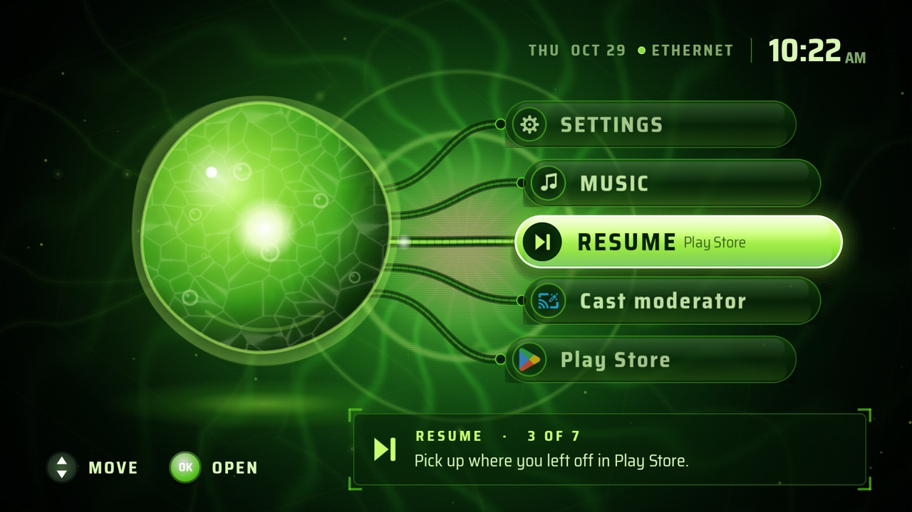
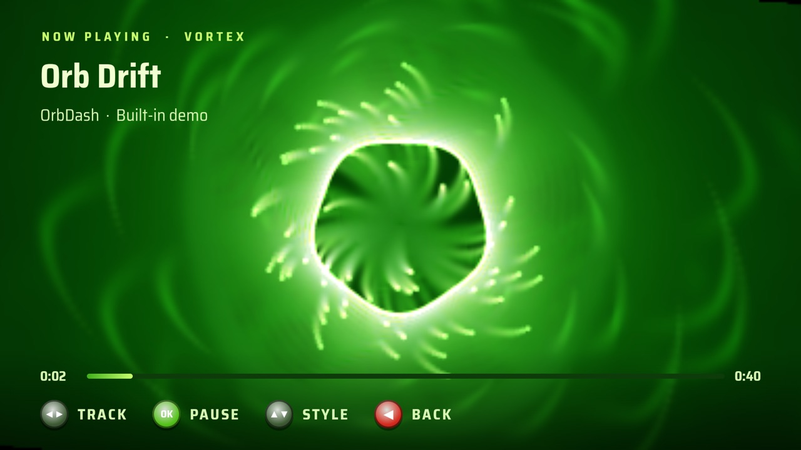
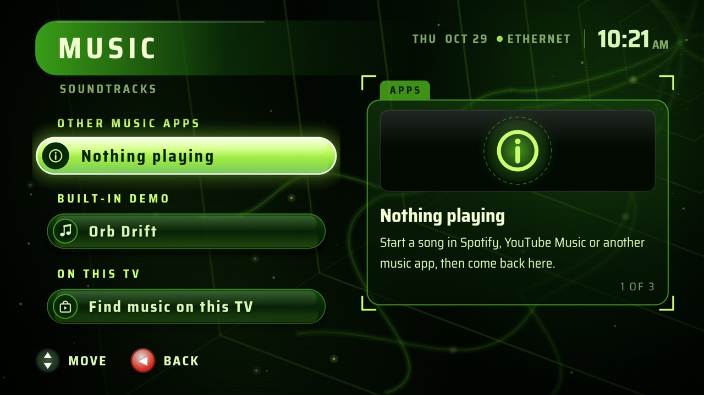
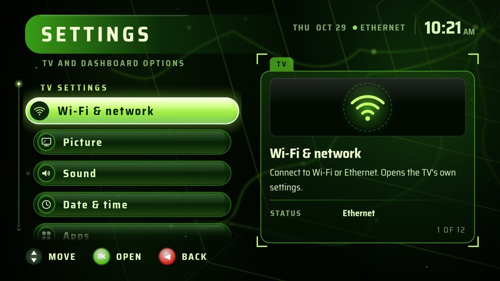
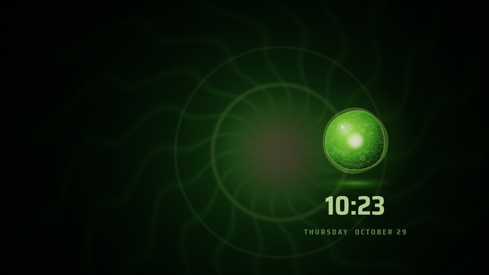

# OrbDash

A home screen for Google TV and Android TV inspired by the green-orb console dashboard of the early 2000s.
Instead of rows of tiles, you get a breathing gel orb, glowing menu pods on tethers, synthesized UI sounds, a music player with a reactive light show, and a drifting screensaver.



| Music light show | Music |
| --- | --- |
|  |  |
| **Settings** | **Screensaver** |
|  |  |

## Features

- **Home wheel.** Five pods around the orb, with the focused one always in the middle. Settings, Music and Resume (the last app you opened) come first, then every installed app.
- **Music player.** Plays the songs on the TV (for example from a USB drive) and a built-in demo track, with three light-show styles that react to the sound.
- **Other music apps.** Shows and controls what Spotify, YouTube Music or another music app is playing, and runs the light show on it (see below).
- **Screensaver.** After a few idle minutes the screen dims to the orb and clock wandering slowly, so nothing burns into the TV. Any button wakes it.
- **Made for the remote.** Arrows to move, OK to open, Back to go back; hints on screen say what each button does.
- **Runs well on budget TVs.** On slower TVs it switches to a lighter drawing mode automatically (Settings → Visual effects).
- **Seven backdrops.** An animated one plus six wallpapers (Settings → Wallpaper).

## Install on a TV

You need a computer with [adb](https://developer.android.com/tools/adb) and a TV running Android TV or Google TV (Android 8.0 or newer).

1. On the TV, turn on developer options: **Settings → System → About**, then press OK on **Android TV OS build** seven times.
2. In **Settings → System → Developer options**, turn on **USB debugging** (on some TVs, "Network debugging").
3. Build the app (see below), then from the computer:

   ```bash
   adb connect <tv-ip-address>:5555
   adb install app/build.nosync/outputs/apk/debug/app-debug.apk
   ```

   Accept the debugging prompt on the TV the first time.
4. Open OrbDash from the TV's app list. It doesn't replace your home screen unless you choose to: pressing Home asks which to use on some TVs, and on others it must be set with adb.

To remove it: `adb uninstall com.orbdash`.

## Build

Requires JDK 17 and the Android SDK (API 35). Open the project in Android Studio, or:

```bash
./gradlew :app:assembleDebug
```

Build output goes to `app/build.nosync/` (the `.nosync` suffix keeps iCloud from syncing it on macOS).

### Try it in an emulator

```bash
./scripts/run-emulator.sh
```

This builds the app and runs it on its own Android TV emulator, `OrbDash_TV`: it creates the emulator the first time, boots it on a free port, installs OrbDash and makes it that emulator's home screen.
It never touches other emulators or a real TV.
Arrow keys and Enter act as the remote's D-pad and OK; Esc is Back.

## Music from other apps

The Music screen can follow Spotify, YouTube Music and other music apps: it shows what's playing, the remote controls it, and the light show reacts to the TV's sound.
This needs OrbDash's **notification access**, which the Music screen offers to open. OrbDash uses it only to see media playback, never to read notifications.
On a TV whose Settings hide that switch, turn it on from a computer:

```bash
adb shell cmd notification allow_listener com.orbdash/com.orbdash.music.MediaListener
```

Notes:
- Apps that stop playing when they leave the screen (YouTube on many TVs) can't be followed.
- Some TVs don't let apps hear other apps' sound. There, the light show pulses to a steady beat instead.
- The emulator can't run Spotify or YouTube, so `testmusic/` is a tiny stand-in ("Test Music") that plays a beat and announces songs the same way:

  ```bash
  ./gradlew :testmusic:assembleDebug && adb install -r testmusic/build.nosync/outputs/apk/debug/testmusic-debug.apk
  ```

## Permissions

| Permission | Why |
| --- | --- |
| Read music / storage | List songs on the TV and USB drives (asked when you choose "Find music on this TV"). |
| Record audio | Required by Android to analyse sound for the light show. Nothing is recorded or saved. Asked once, before the first light show. |
| Notification access | Optional; lets the Music screen follow other music apps. |
| Network state | Shows Wi-Fi / Ethernet status in the corner. |

## Troubleshooting

Music problems are logged under one tag:

```bash
adb logcat -s OrbDashMusic
```

## Project layout

- `app/src/main/java/com/orbdash/` — app list (`AppRepository`), app labels (`Category`), UI sounds (`Sfx`)
- `app/src/main/java/com/orbdash/ui/` — orb, backdrop, home wheel, lists, light show, screensaver, intro
- `app/src/main/java/com/orbdash/music/` — player, library scan, demo track, light-show renderer, other-app connection
- `testmusic/` — emulator-only stand-in music app
- `scripts/run-emulator.sh` — build and run on the dedicated emulator

Tested on the Android TV emulator (API 35) and a TCL Google TV (Android 12).

## License

The code is under the [MIT License](LICENSE). Exceptions, also listed in [LICENSE](LICENSE):

- The six wallpapers (`app/src/main/res/drawable-nodpi/wp_*.jpg`) are © MattDillionCodes, all rights reserved.
- The font, Saira Semi Condensed, is under the [SIL Open Font License](licenses/Saira-OFL.txt).

OrbDash is a fan-made project. It is not affiliated with, endorsed by, or connected to Microsoft or Xbox, and contains no Microsoft code, artwork or sounds. The orb, interface sounds and demo music were made for this project.
